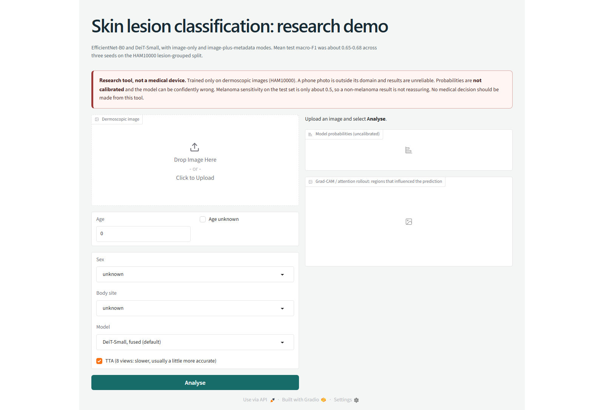
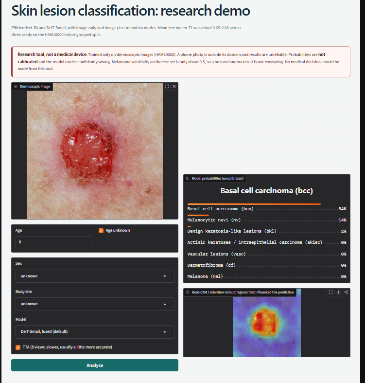
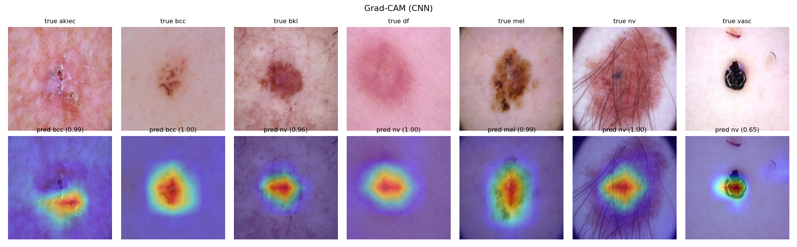
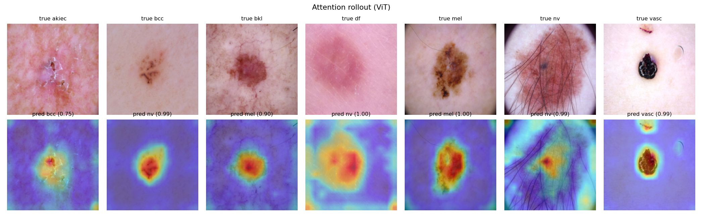

# DermFuse

DermFuse is a research project comparing image-only and image-plus-metadata
deep-learning models for seven-class skin-lesion classification on HAM10000.

The project compares an EfficientNet-B0 convolutional neural network with a
DeiT-Small Vision Transformer. Patient age, sex, and body-site metadata can be
concatenated with image features through a fusion network.

## Application preview



### Example inference result



Example model output for demonstration only; it is not medical advice.

> **Research disclaimer:** This project is not a medical device and must not
> be used for diagnosis or treatment decisions. HAM10000 contains dermoscopic
> images, while phone photographs are outside the demonstrated domain.
> Probabilities are uncalibrated and melanoma sensitivity is limited.

## Features

- Seven-class HAM10000 lesion classification
- EfficientNet-B0 CNN baseline
- DeiT-Small pretrained Vision Transformer
- Image-only, metadata-only, and fused-input experiments
- Lesion-level, stratified train/validation/test splitting
- Class-weighted cross-entropy, power 1.0 screening, and focal-loss screening
- Test-time augmentation
- Grad-CAM explainability for the CNN
- Attention-rollout explainability for the Vision Transformer
- Metadata attribution using SHAP
- Local Gradio inference demo

## Dataset

This project uses the HAM10000 dataset:

- 10,015 dermoscopic images
- 7,470 unique lesions
- Seven diagnostic classes
- Metadata: age, sex, body site, lesion identifier, and diagnosis

| Code  | Diagnostic class                              |
| ----- | --------------------------------------------- |
| akiec | Actinic keratoses / intraepithelial carcinoma |
| bcc   | Basal cell carcinoma                          |
| bkl   | Benign keratosis-like lesion                  |
| df    | Dermatofibroma                                |
| mel   | Melanoma                                      |
| nv    | Melanocytic nevus                             |
| vasc  | Vascular lesion                               |

The split is grouped by `lesion_id` to reduce leakage from multiple images of
the same lesion. HAM10000 does not provide patient identifiers, so lesions from
the same patient may not be perfectly distinguishable. Dataset images are not
included in this repository.

HAM10000 is distributed under the CC BY-NC-SA 4.0 license. Verify the applicable
dataset terms and attribution requirements before redistribution.

## Project files

| File                     | Purpose                                                                        |
| ------------------------ | ------------------------------------------------------------------------------ |
| `app.py`                 | Local Gradio inference interface                                               |
| `prepare_meta_stats.py`  | Builds metadata normalization statistics from the training split               |
| `DermFuse(kaggle).ipynb` | Kaggle training, evaluation, imbalance, bootstrap, and explainability notebook |
| `requirements.txt`       | Python dependencies for the demo                                               |
| `README.md`              | Project setup and documentation                                                |
| `.gitignore`             | Excludes environments, datasets, logs, metadata statistics, and model weights  |

The notebook is a cleaned, reproducible copy. Model checkpoints and local
datasets are intentionally excluded from Git.

## Model architecture

### CNN

- Backbone: `efficientnet_b0` from `timm`
- Image feature size: 1280
- Fused feature size: 1312 with 20 metadata features

### Vision Transformer

- Backbone: `deit_small_patch16_224` from `timm`
- Image feature size: 384
- Fused feature size: 416 with 20 metadata features

### Metadata encoding

The metadata vector contains 20 features:

- Age: standardized after training-set median imputation
- Missing-age indicator: 1 feature
- Sex: one-hot encoded, with unknown sex supported
- Body site: one-hot encoded

Metadata statistics must be calculated only from the training split.

### Fusion head

Both fusion models concatenate image features and metadata features, then use:

```text
Linear -> ReLU -> Dropout(0.3) -> Linear -> Seven-class logits
```

## Experimental setup

- Image size: 224 x 224
- Optimizer: AdamW
- Weight decay: 0.01
- Maximum epochs: 25
- Batch size: 32
- Early stopping: validation macro-F1
- Primary metric: macro-F1
- Additional metrics: balanced accuracy, accuracy, AUC, and melanoma sensitivity
- Cross-entropy class-weight power: 0.5
- Seeds: 1, 2, and 42

The final fixed-split multi-seed comparison used class-weighted
cross-entropy at power 0.5. Imbalance screening evaluated power 1.0 and focal
loss at one seed, but the predefined validation-only selection rule did not
replace the power-0.5 baseline.

## Results

Mean results across seeds 1, 2, and 42:

| Configuration               | Test macro-F1 | Test accuracy | Test AUC | Melanoma sensitivity |
| --------------------------- | ------------: | ------------: | -------: | -------------------: |
| EfficientNet-B0, image-only |         0.664 |         0.808 |    0.949 |                0.544 |
| EfficientNet-B0, fused      |         0.647 |         0.815 |    0.953 |                0.539 |
| DeiT-Small, image-only      |         0.683 |         0.823 |    0.954 |                0.520 |
| DeiT-Small, fused           |         0.677 |         0.825 |    0.955 |                0.548 |
| Metadata-only MLP           |         0.249 |         0.658 |    0.759 |                0.284 |

These are descriptive results from three training seeds on one fixed test split.
The differences are not presented as proof of a statistically reliable backbone
or fusion advantage.

### Key findings

- DeiT-Small had slightly higher mean macro-F1 than EfficientNet-B0.
- Metadata fusion did not improve macro-F1, although it slightly increased
  accuracy and AUC in the reported runs.
- Melanoma sensitivity remained limited, approximately 0.52-0.55 across the
  image-based models.
- The metadata-only model performed substantially worse than image-based models.
- Rare-class estimates are unstable because the test split contains very small
  numbers of dermatofibroma and vascular-lesion images.
- The models have no external or clinical validation.

## Explainability

### CNN: Grad-CAM



Grad-CAM highlights image regions that influenced the EfficientNet-B0
prediction. The heatmap is an attribution aid, not a lesion boundary or a
clinical explanation.

### Vision Transformer: attention rollout



Attention rollout visualizes the DeiT-Small model's propagated attention. It
does not establish causation and should not be interpreted as a diagnosis.

## Run the demo

### 1. Create a virtual environment

```powershell
python -m venv .venv
.\.venv\Scripts\Activate.ps1
python -m pip install -r requirements.txt
```

### 2. Prepare metadata statistics

Place HAM10000 in a local directory containing `HAM10000_metadata.csv` and its
JPEG images, or use the default `ham_subset` folder at the repository root.

```powershell
$env:HAM10000_DIR = "D:\datasets\HAM10000"
python prepare_meta_stats.py --data-dir "$env:HAM10000_DIR"
```

The default saved split is `dermfuse_out/split.csv`. This writes
`meta_stats.json` locally; that generated file is excluded from Git.

### 3. Add model checkpoints

Place the four seed-42 checkpoints in `weights/`:

```text
weights/
  cnn_fused_ce_p0.5_s42.pt
  cnn_image_ce_p0.5_s42.pt
  vit_fused_ce_p0.5_s42.pt
  vit_image_ce_p0.5_s42.pt
```

The weights are excluded by `.gitignore`. Obtain or generate them separately
and distribute them only if the applicable model and data terms permit it.

### 4. Start the app

```powershell
python app.py
```

Open the local Gradio address printed in the terminal. The app is configured
to bind only to `127.0.0.1` and does not create a public share link.

## Run the Kaggle notebook

Upload [`DermFuse(kaggle).ipynb`](<DermFuse(kaggle).ipynb>) to Kaggle or import it
into a Kaggle-compatible notebook environment.

Recommended settings:

- GPU: T4
- Internet: enabled when pretrained `timm` weights need downloading
- Input: `Skin Cancer MNIST: HAM10000`

Run stages in this order:

1. `screen`
2. `analysis`
3. `final`
4. `analysis`
5. `xai`

The notebook preserves a fixed lesion-grouped split and avoids re-running
completed configurations.

## Limitations

- Trained on one dermoscopic dataset
- No external or prospective validation
- Strong class imbalance
- Small test counts for several rare classes
- Possible lesion-level or shortcut artifacts
- Uncalibrated probabilities
- Limited melanoma sensitivity
- No claim of clinical readiness

Grad-CAM and attention rollout show where a model focuses; they do not prove
why a lesion is malignant or benign.
